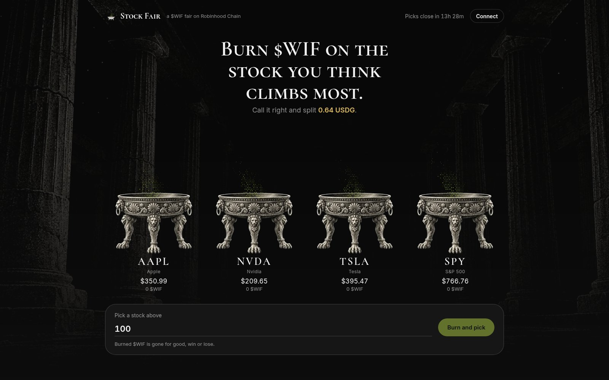
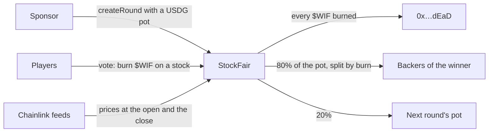

<div align="center">


# Stock Fair

**Burn $WIF on the stock you think climbs most. Call it right and split the USDG pot.**<br>
A new round every US market day, on Robinhood Chain mainnet.

[Live app](https://stock-fair.timidan.xyz) · [Mainnet rounds](#mainnet-rounds) · [How it works](#how-it-works) · [Who pays](#who-pays) · [Contract](https://robinhoodchain.blockscout.com/address/0x16e7f897c6ee9394fbf08716515c66e8b6f85937) · [Quickstart](#quickstart)


</div>



Every weekday, Stock Fair opens a round on four Stock Tokens: AAPL, NVDA, TSLA and SPY. Before the US market opens, $WIF holders burn $WIF on the stock they think will gain most by the close. At the close, the contract reads Chainlink's prices on chain. Everyone who backed the winner splits 80% of the pot in proportion to their burn, and 20% rolls into the next round. It is the WIF team's own format, burn to vote, pointed at the stocks on Robinhood Chain.

> [!IMPORTANT]
> Burned $WIF is gone for good, win or lose. Picks close at the US open (09:30 New York time) and each round settles on the close (16:00).

## Highlights

- **Burn to pick.** A vote moves $WIF straight to the dead address. Your share of the $WIF burned on the winner is your share of the pot.
- **Real stocks, real prices.** Robinhood Chain's AAPL, NVDA, TSLA and SPY tokens, scored on Chainlink's prices at the open and the close.
- **Pots that grow.** Winners split 80%. The other 20% carries into the next round, and a round nobody called carries in full.
- **No admin.** The contract has no owner, no pause and no upgrade. Anyone can settle a round, and the contract checks the price proofs itself.
- **Runs itself.** A keeper opens a round every weekday and settles it after the close. The page reads the chain directly, with no backend.
- **Open to sponsors.** `createRound` is public, so any project can put up a pot for its own community.

## Built with

| | Used for |
|---|---|
| **$WIF** | The only way to pick. Every vote burns it. |
| **Stock Tokens** | AAPL, NVDA, TSLA and SPY on Robinhood Chain. |
| **Chainlink data feeds** | Each stock's price at the lock and the close, checked by the contract. |
| **USDG** | The pot. |

Also used: Solidity, Foundry, viem, React, Vite, Docker.

## How it works



1. **Open.** The keeper calls `createRound` after 00:00 UTC on each weekday with a 0.8 USDG pot, plus whatever carried from earlier rounds.
2. **Pick.** Until the US open, players burn $WIF on one or more stocks. Every $WIF is one vote.
3. **Settle.** After the close, anyone calls `settle` with the Chainlink round that was current at the lock and at the close for each stock. The contract checks that each is the last round at or before that moment. The stock with the highest return wins; ties share.
4. **Claim.** Backers of the winner press **Claim USDG** on the page.

A stale price voids the round: the sponsor takes back the deposit, and any carry returns to the next pot. A feed paused for a corporate action makes settlement wait instead. Only the four approved stock and feed pairs can be used.

## Who pays

- **Sponsors pay the pot.** We seed 0.8 USDG per weekday round from our own wallet. Any project can sponsor a round the same way.
- **Players pay in $WIF, by burning it.** At about $0.00125 per $WIF, 1 USDG buys about 800 $WIF. A burn is worth making when your share of the pot is worth more than the $WIF you burned.
- **Winners take 80%; 20% carries.** Pots grow from round to round, bigger pots are worth bigger burns, and every burn takes $WIF out of supply for good.

Burns never refill the pot; only sponsors do. If nobody sponsors, rounds stop.

## Mainnet rounds

Every round the contract has run, with links to each transaction. The table is rebuilt from the contract's events after each round settles, and rows for upcoming rounds show their schedule.

<!-- rounds -->
**1 round so far · 168 $WIF burned · 0.64 USDG paid to winners.** Built from the contract's events by `node keeper/proof.mjs`, last run 2026-10-30 20:13 UTC.

| Round | Day | Pot | Opened | $WIF burned | Settled | Winner | Paid out |
|---|---|---|---|---|---|---|---|
| 1 | Fri 30 Oct | 0.8 USDG | [00:00 UTC](https://robinhoodchain.blockscout.com/tx/0x06b7163fce4e763a22989cf11b544a8ffb682a8994935f9e4ae95999d2002903) | 168 $WIF · [1](https://robinhoodchain.blockscout.com/tx/0x14385ed3cfba388e5238c2c199a3fca037e1da9b3dae5783a20afe84ae78c370) [2](https://robinhoodchain.blockscout.com/tx/0x3a153db985a480782a612e551a5d5b4bfbef34f97090fee58f5432266a9f4848) [3](https://robinhoodchain.blockscout.com/tx/0x0321518e6e8af4926d88faa66127df6c4502d5b920c042388c82d10ef58af116) [4](https://robinhoodchain.blockscout.com/tx/0x71faa6d4e5d70f99079818491f6306eb0b8c3e2a2ba18add6bff58260c7b7f04) | [settle](https://robinhoodchain.blockscout.com/tx/0x7a8394533b1159a1608f175a3e2e39c28058018f0d9340042480e95a747546f5) | TSLA +1.04% | 0.64 USDG · [1](https://robinhoodchain.blockscout.com/tx/0x056df886426e6740af7abe96e0a5c3b47b82d1f6ca6c22d2d24323a4a8d6c06b) |
|  | Mon 2 Nov | 0.8 USDG + carry | opens 00:00 UTC | picks close 14:30 UTC | after 21:00 UTC |  |  |
|  | Tue 3 Nov | 0.8 USDG + carry | opens 00:00 UTC | picks close 14:30 UTC | after 21:00 UTC |  |  |
|  | Wed 4 Nov | 0.8 USDG + carry | opens 00:00 UTC | picks close 14:30 UTC | after 21:00 UTC |  |  |
|  | Thu 5 Nov | 0.8 USDG + carry | opens 00:00 UTC | picks close 14:30 UTC | after 21:00 UTC |  |  |
|  | Fri 6 Nov | 0.8 USDG + carry | opens 00:00 UTC | picks close 14:30 UTC | after 21:00 UTC |  |  |
|  | Mon 9 Nov | 0.8 USDG + carry | opens 00:00 UTC | picks close 14:30 UTC | after 21:00 UTC |  |  |
|  | Tue 10 Nov | 0.8 USDG + carry | opens 00:00 UTC | picks close 14:30 UTC | after 21:00 UTC |  |  |
|  | Wed 11 Nov | 0.8 USDG + carry | opens 00:00 UTC | picks close 14:30 UTC | after 21:00 UTC |  |  |
|  | Thu 12 Nov | 0.8 USDG + carry | opens 00:00 UTC | picks close 14:30 UTC | after 21:00 UTC |  |  |
|  | Fri 13 Nov | 0.8 USDG + carry | opens 00:00 UTC | picks close 14:30 UTC | after 21:00 UTC |  |  |
|  | Mon 16 Nov | 0.8 USDG + carry | opens 00:00 UTC | picks close 14:30 UTC | after 21:00 UTC |  |  |
<!-- /rounds -->

| | |
|---|---|
| StockFair | [`0x16e7f897c6ee9394fbf08716515c66e8b6f85937`](https://robinhoodchain.blockscout.com/address/0x16e7f897c6ee9394fbf08716515c66e8b6f85937) · [source verified on Sourcify](https://repo.sourcify.dev/4663/0x16E7F897C6eE9394Fbf08716515c66e8b6f85937) (exact match) |
| Deployed | block 101,105,934 · [`0x5c2ade02…`](https://robinhoodchain.blockscout.com/tx/0x5c2ade02b2c627a3d8251a6b2d3fc2e73d7bc33091603bef093f585d311caccd) |
| Keeper and sponsor | [`0x1589bbF98a1fa76607F7f4139F1188511407Dc32`](https://robinhoodchain.blockscout.com/address/0x1589bbF98a1fa76607F7f4139F1188511407Dc32) |
| $WIF | `0x5173b8eA6923c2d40267890D45C46a3480954773` |
| USDG | `0x5fc5360D0400a0Fd4f2af552ADD042D716F1d168` |
| Stock Tokens and feeds | [SPEC.md](SPEC.md#chain-and-addresses-robinhood-chain-mainnet-id-4663) |

## Try it

1. Open the [live app](https://stock-fair.timidan.xyz). It shows the round, live Chainlink prices and the $WIF burned on each stock, with no wallet needed.
2. To play, connect a wallet on Robinhood Chain that holds $WIF, pick a brazier and press **Burn and pick**.
3. After the close, the oracle tablet shows the result. Winners press **Claim USDG**.

## Quickstart

```bash
cd contracts && forge test               # 12 fork tests against Robinhood Chain mainnet
cd ui && npm install && npm run dev      # http://localhost:5173
```

A full round on a local fork, replaying real Chainlink prices (about 7 minutes):

```bash
anvil --fork-url https://rpc.mainnet.chain.robinhood.com --chain-id 4663
bash demo/round.sh                       # then open the URL it prints
```

The public RPC prunes old state after a few minutes, so start a fresh fork right before the demo.

## Keeper

`keeper/keeper.mjs` runs every 10 minutes from cron. Each run does only what is due: settle a round that has closed, refund a void round it sponsored, or open today's round. `keeper/proof.mjs` rebuilds the table above from the contract's events (`node keeper/proof.mjs --write`).

| Variable | Default | Purpose |
|---|---|---|
| `KEEPER_KEY` | — | Sponsor key, never logged |
| `STOCK_FAIR` | — | Contract address |
| `POT_USDG` | `5` | USDG per round (mainnet runs 0.8) |
| `RPC` | public RPC | Robinhood Chain RPC |
| `LOCK_UTC` · `END_UTC` | NYSE session | `HH:MM` overrides for the lock and the close |

## Project structure

```
contracts/   StockFair.sol, fork tests, deploy and price-round scripts
ui/          the page (Vite, React, viem); the fire is driven by the real $WIF burned
keeper/      keeper.mjs opens and settles rounds; proof.mjs rebuilds the rounds table
demo/        a full round on a local fork, replaying real Chainlink prices
docs/        security review and screenshots
```

## Docs

- [SPEC.md](SPEC.md): the contract's rules, round by round
- [contracts/README.md](contracts/README.md): tests, ABI and scripts
- [docs/security-review.md](docs/security-review.md): a security review of the first version, with what was fixed and why
